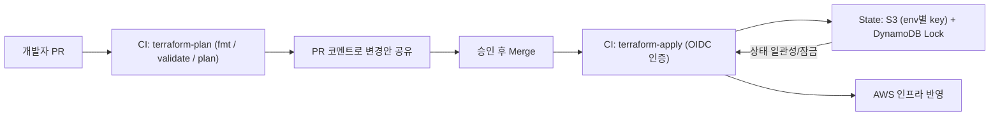

# 인프라 개요: 요구사항, 노드 전략, 배포·운영 의사결정

> 원본: Notion "발표 준비(인프라)" (최종 발표 대본, 2026-02-24). 작성: 인프라·배포 설계 담당. 발표 대본을 설계 요약 문서로 재구성.

## 1. 시스템 요구사항

| 구분 | 목표 |
| --- | --- |
| 평상시 트래픽 | 10 ~ 50 TPS |
| 팝업 오픈 트래픽 | 1,000 ~ 10,000 TPS (평시 대비 100~1000배) |
| 피크 지속 | 5 ~ 30분, 오픈 시각 사전 공지(예측 가능) |
| 가용성 | 99.9% 이상 |
| 응답 시간 | P95 < 500ms |
| 확장 | 피크 30~60초 내 대응 |
| 보안 | 결제정보·개인정보 보호 |

핵심 목표: (1) 평상시 비용 절감, (2) 급증 트래픽의 빠른 흡수, (3) 결제·개인정보 서비스의 안정성과 추적 가능성.

## 2. 시스템 구성 요약
- Route 53 도메인 기반 진입, ALB 2개로 분리
  - Public ALB: 주문·결제·조회 등 사용자 트래픽
  - Management ALB: ArgoCD·Grafana·Kafka UI, 허용 IP만 접근
- 8개 서비스(Users, Stores, Order, OrderQuery, Payment, Checkin, Gateway, Coupon) + Frontend를 독립 배치해 서비스별 확장 정책과 리소스 예산 적용
- Order/Payment 이벤트는 Kafka로 흘려 OrderQuery에서 CQRS 조회 분리
- DB는 단일 PostgreSQL에 서비스별 스키마·권한 분리(비용과 격리의 균형)

## 3. 노드 전략 (Karpenter + HPA)
- **두 계층 분리**
  - 시스템 워크로드(클러스터 필수 컴포넌트): **고정 Managed Node Group**
  - 서비스 워크로드: **Karpenter 동적 NodePool**, 수요에 따라 즉시 확장/축소
- **구매 옵션**: 동적 NodePool은 Spot 우선, Spot 회수·안정성 필요 구간은 On-Demand 보완
- **Consolidation**: 사용량 감소 시 유휴 노드 정리로 비용 절감
- **선택 이유**: 고정 ASG는 인스턴스 타입·용량이 정해져 있어 급변 수요에 반응 속도·효율 한계. Karpenter는 Pod 스케줄링 조건(리소스, 제약, AZ)에 맞춰 인스턴스 타입을 동적으로 선택

## 4. Terraform 운영 방식

- State는 S3 원격 저장, dev/prod key 분리, DynamoDB 락으로 동시 apply 경합 차단
- **로컬 apply 금지, GitHub Actions에서만 apply** → 변경 추적성, PR 리뷰 기반 반영, 환경 간 state 꼬임 방지

## 5. 배포 전략
- **Umbrella Helm Chart**: `popcorn-umbrella` 아래 서비스별 하위 차트 + `common` 라이브러리 차트. 환경 차이(리소스, 도메인, Ingress, Observability)는 `values-dev.yaml`/`values-prod.yaml` 오버라이드
- 서비스별 부분 배포/롤백과 전체 일괄 배포 모두 가능
- **ArgoCD GitOps**: Git을 단일 진실 공급원으로, 환경별 Helm 배포를 지속 동기화
- **배포 방식**: 전 서비스 Argo Rollout(Blue/Green + preview service). 주문·결제·게이트웨이 등 핵심 서비스는 단계적 승격 대상

## 6. 모니터링 전략
- OpenTelemetry Java Agent + Fluent Bit + LGTM(Grafana, Loki, Tempo, Mimir)
- Collector가 트레이스(Tempo)/메트릭(Mimir)/로그(Loki)로 라우팅, Fluent Bit이 stdout 로그에 K8s 메타데이터를 붙여 Loki 적재
- Grafana Alerting → Discord
- 대시보드 3종(Logs/Metrics/Traces Operations) 상세는 `grafana-signal-dashboards.md`

## 7. 운영 대응
- **트래픽 급증**: NodePool + Consolidation, Spot 우선/On-Demand 보조
- **장애 대응**: Pod Pending, CrashLoopBackOff, DB 실패, Kafka lag 알람 → 1차/2차 대응 단계와 Runbook
- **데이터 일관성**: DB 트랜잭션 경계 명확화, Kafka idempotent consumer와 재시도, DLQ/오프셋/재처리 정책
- **장애 복구 정책**: Dev는 빠른 실험, Prod는 Multi-AZ/백업/PITR/알림 기준 분리
- **트러블슈팅 원칙**: 배포형 장애(values 오타, ConfigMap 키 불일치 등)는 앞단 트래픽을 유지한 채 영향 서비스만 최소 범위 롤백
