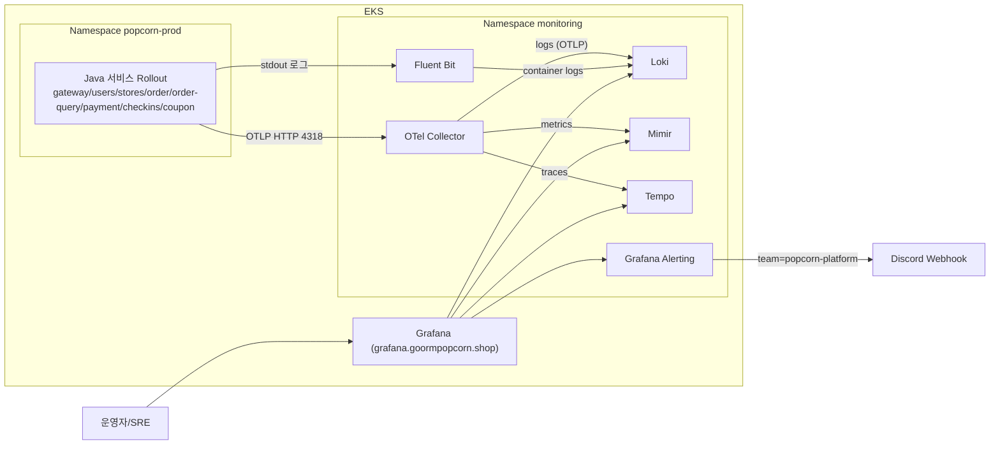

# Popcorn 운영 모니터링 구조 및 런북

> 원본: Notion "Popcorn 운영 모니터링 구조" (Infra > 작업목록, 모니터링). 작성: 인프라·배포 설계 담당, 2026-02-23.
> 파일 경로는 `popcorn_deploy` 저장소 기준 상대 경로.

## 1. 배경
- 로그/메트릭/트레이스 수집 경로, 실제 수집값, 알람 룰 관리 방식, LGTM 조회 방법이 문서마다 흩어져 있었다.
- 알람 룰은 Grafana UI가 아닌 GitOps 파일로 관리되므로 템플릿과 절차가 없으면 변경 실수가 생기기 쉽다.

## 2. 현재 운영 구조 (실 클러스터 기준)
- ArgoCD App: `popcorn-prod-infrastructure-lgtm` (Synced/Healthy)
- `monitoring` 네임스페이스: Grafana, Loki, Tempo, Mimir, Fluent Bit, OTel Collector
- 앱(`popcorn-prod`)은 Argo Rollout으로 운영, Java 서비스에는 OTel Java Agent 주입



## 3. 설정 파일 위치
| 항목 | 경로 |
| --- | --- |
| LGTM ArgoCD 앱 | `applications/prod/infrastructure-lgtm.yaml` |
| Grafana datasource (Loki/Tempo/Mimir) | `infrastructure/lgtm/argocd-chart/values.yaml` |
| Fluent Bit (tail + kubernetes filter + loki output) | `infrastructure/lgtm/argocd-chart/values.yaml` |
| OTel Collector 파이프라인 | `infrastructure/otel/values.yaml` |
| Java Agent / OTEL env (prod) | `helm/popcorn-umbrella/values-prod.yaml` |
| Grafana Alerting (contact point/policy/rules) | `infrastructure/lgtm/argocd-chart/values-prod.yaml` |

## 4. 알람 라우팅
- Contact Point: `popcorn-slo` (Discord)
- Policy: `team=popcorn-platform` 라벨 매칭 시 `popcorn-slo`로 전달
- `group_by: [alertname, job, severity]`, `group_wait: 30s`, `group_interval: 5m`, `repeat_interval: 4h`

## 5. 수집 데이터
**Loki**
- 라벨: `container`, `job`, `namespace`, `pod`, `service_name`, `stream`
- 본문 필드: `@timestamp`, `level`, `service`, `traceId`, `httpMethod`, `path`, `logger`, `message`, `kubernetes.*`

**Mimir**
- job: `popcorn/{checkins,coupon,gateway,order,order-query,payment,stores,users}`
- 메트릭군: `http_server_request_duration_seconds_*`, `http_client_request_duration_seconds_*`, `jvm_*`, `db_client_connections_*`, `kafka_consumer_*`, `otel_sdk_span_*`, `otlp_exporter_*`

**Tempo**
- `service.name`: checkins, gateway, order, order-query, payment, stores, users (coupon은 트래픽 발생 시점에 따라 늦게 보일 수 있음)
- 주요 속성: `service.namespace`, `deployment.environment`, `http.request.method`, `http.response.status_code`, `http.route`, `db.system`, `db.statement`

## 6. 검증 결과
- `monitoring` 네임스페이스 컴포넌트 전체 Running
- Grafana datasource API로 Loki/Mimir/Tempo 연결 확인
- Grafana Alerting API에서 운영 룰 5개 활성(`isPaused=false`)
- Grafana Ingress 접속 시 로그인 리다이렉트 확인

## 7. 알람 룰 추가 템플릿 (GitOps)
`infrastructure/lgtm/argocd-chart/values-prod.yaml`의 `grafana.alerting.rules.yaml.groups[0].rules`에 추가한다.

```yaml
- uid: popcorn-<service>-<signal>-<severity>
  title: "<서비스> <지표> 임계치"
  condition: C
  data:
    - refId: A
      relativeTimeRange: { from: 300, to: 0 }
      datasourceUid: mimir
      model:
        datasource: { type: prometheus, uid: mimir }
        editorMode: code
        expr: <PROMQL>
        instant: true
        intervalMs: 1000
        maxDataPoints: 43200
        range: false
        refId: A
    - refId: C
      relativeTimeRange: { from: 0, to: 0 }
      datasourceUid: "-100"
      model:
        conditions:
          - evaluator: { params: [<THRESHOLD>], type: gt }
            operator: { type: and }
            query: { params: [A] }
            reducer: { params: [], type: last }
            type: query
        datasource: { type: __expr__, uid: "-100" }
        expression: A
        intervalMs: 1000
        maxDataPoints: 43200
        refId: C
        type: threshold
  for: 10m
  noDataState: NoData
  execErrState: Error
  annotations:
    summary: "<한 줄 요약>"
    description: "<상세 설명>"
  labels:
    severity: warning
    team: popcorn-platform
    category: slo
    job: popcorn/<service>
  isPaused: false
```

**절차**
1. `values-prod.yaml`에 룰 추가
2. `helm lint infrastructure/lgtm/argocd-chart`
3. push 후 ArgoCD `popcorn-prod-infrastructure-lgtm` sync 확인
4. Grafana API `/api/v1/provisioning/alert-rules`로 룰 확인
5. Discord에서 발생/해제 알림 수신 확인

**주의**: 룰 UID 변경 시 기존 UID가 남으므로 `deleteRules`를 함께 추가한다. Contact point UID 변경 시 `deleteContactPoints`도 관리한다.

## 8. LGTM 쿼리셋

### Loki (LogQL)
```text
# popcorn-prod 전체 ERROR
{namespace="popcorn-prod"} |= "ERROR"
# users 서비스 최근 오류
{namespace="popcorn-prod", pod=~"popcorn-prod-users-.*"} |= "ERROR"
# gateway 5xx 관련 로그
{namespace="popcorn-prod", pod=~"popcorn-prod-gateway-.*"} |= " 5"
```

### Mimir (PromQL)
```text
# 서비스별 RPS (5m)
sum by (job) (rate(http_server_request_duration_seconds_count{job=~"popcorn/.*"}[5m]))

# 서비스별 5xx 비율 (%)
100 * sum by (job) (rate(http_server_request_duration_seconds_count{job=~"popcorn/.*",http_response_status_code=~"5.."}[5m]))
  / clamp_min(sum by (job) (rate(http_server_request_duration_seconds_count{job=~"popcorn/.*"}[5m])), 0.001)

# 서비스별 P95 지연 (초)
histogram_quantile(0.95, sum by (job, le) (rate(http_server_request_duration_seconds_bucket{job=~"popcorn/.*"}[5m])))

# Trace coverage (span/request)
sum by (job) (rate(otel_sdk_span_started_total{job=~"popcorn/.*"}[5m]))
  / clamp_min(sum by (job) (rate(http_server_request_duration_seconds_count{job=~"popcorn/.*"}[5m])), 0.001)

# JVM Heap 사용률 (%)
100 * sum by (job) (jvm_memory_used_bytes{job=~"popcorn/.*",jvm_memory_type="heap"})
  / clamp_min(sum by (job) (jvm_memory_limit_bytes{job=~"popcorn/.*",jvm_memory_type="heap"}), 1)
```

### Tempo
- `service.name = "gateway"`, `http.request.method = "GET"`, `http.response.status_code >= 500`, `db.system = "postgresql"`

### API 점검 (클러스터 내부)
```bash
curl -s "http://mimir-nginx/prometheus/api/v1/label/job/values"   # Mimir job 목록
curl -s "http://tempo:3200/api/search/tag/service.name/values"    # Tempo 서비스 목록
curl -s "http://loki:3100/loki/api/v1/labels"                     # Loki 라벨 목록
```

## 9. 잔여 항목 / 신규 서비스 온보딩
- coupon 트레이스 상시 노출 여부 점검
- Discord resolve 메시지 정책(`disableResolveMessage`) 조정 여부
- 신규 서비스 추가 시: OTEL 서비스명·job 라벨 확인, 기본 대시보드 쿼리 반영, SLO 룰/라벨(`team=popcorn-platform`) 반영
